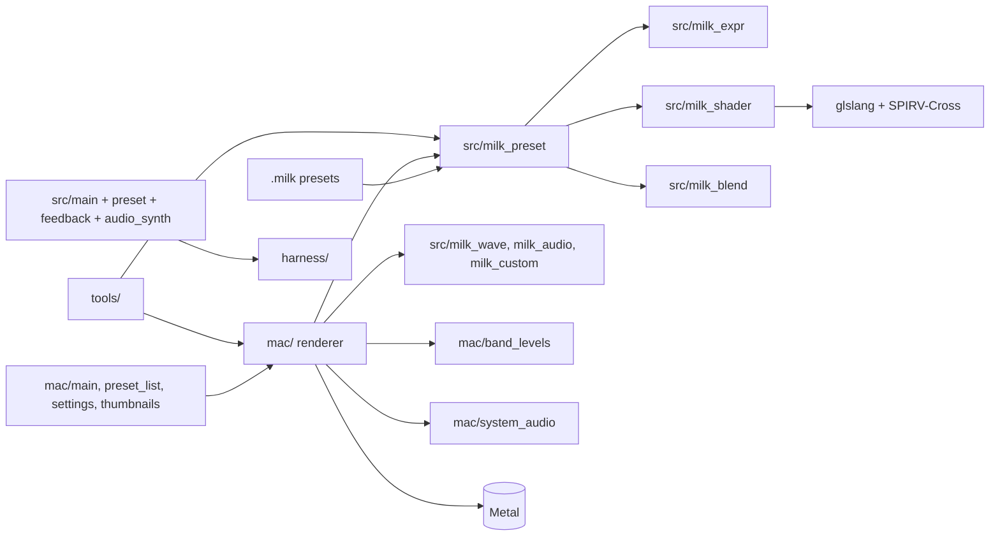

# Architecture

## Overview

Afterimage draws MilkDrop-style feedback visuals. Each frame is the previous frame resampled through a warp mesh, faded, and drawn over with waveforms and shapes. A preset (a `.milk` file) supplies the equations, shaders and shapes that steer that loop. The built-in motions play the part of a preset when none is loaded.

Two programs share one renderer library:

- **Afterimage**, the macOS app in `mac/`. It renders `.milk` presets on the GPU with Metal at up to 120 Hz, listens to system audio through a Core Audio process tap, and has the preset list, gallery and settings windows.
- **`milk_effect`**, a Turret effect built from `src/main.cpp` on the SDL3 backend. It runs the built-in motions on the CPU against a deterministic synthesiser. It is the original form of the project and stays deterministic so Turret can snapshot and replay it.

The command-line tools in `tools/` link the same library and the Mac renderer to check presets without opening a window.

## Codemap

### `src/`

Platform-free C++ shared by both programs. Nothing here calls Cocoa, Metal or SDL, except `main.cpp`, which goes through the Turret harness.

- `milk_preset.*` reads `.milk` files and runs their `per_frame_init`, `per_frame` and `per_pixel` code.
- `milk_expr.*` is a compiler and interpreter for MilkDrop's expression language, following projectm-eval, which Milkwave 4.1 uses.
- `milk_shader.*` translates a preset's HLSL warp and composite shaders to Metal source.
- `milk_blend.*` makes the patterns that mix one preset into the next.
- `milk_wave.*` draws the main waveform in MilkDrop's wave modes.
- `milk_custom.*` runs a preset's custom waves and shapes.
- `milk_audio.*` builds the waveform and spectrum that waves read.
- `feedback.*` computes the warp mesh and holds the CPU feedback buffer.
- `preset.*` holds the knobs, built-in motions and per-frame equations.
- `audio_synth.*` is the deterministic synthesiser and its band levels.
- `main.cpp` is the Turret effect: callbacks, knobs, drawing and snapshots.

### `mac/`

The Afterimage app. See `mac/CLAUDE.md` for working rules.

- `renderer.*` owns a frame: preset playback, blending, the feedback and blur images, and the draw passes.
- `shaders.metal` holds the fixed vertex stages and passes. It is read from the app bundle at run time.
- `preset_gpu.*` turns a translated preset into Metal pipelines.
- `texture_bank.*` supplies the noise and image textures a shader samples by name.
- `custom_geometry.*` builds the vertices for custom waves and shapes.
- `band_levels.*` is MilkDrop 2's sound analysis, giving `bass`, `mid` and `treb`.
- `system_audio.*` taps the output device and lists output devices.
- `preset_list.*`, `thumbnails.*` and `settings.*` are the list and gallery window, the thumbnail cache, and the settings window.
- `main.mm` builds the menus and the window and handles keys.

### `tools/`

Command-line checks and test programs. `TESTING.md` lists what each one is for.

### `harness/`

Turret's harness headers, vendored. Do not edit them.

## Frame pipeline

A frame runs in MilkDrop 2's order: motion vectors drawn onto the previous image, the warp (the preset's warp shader if it has one), custom shapes, custom waves, the main waveform, darken-centre, the outer and inner borders, then the composite.

The CPU computes the warp mesh with `computeMesh` in `feedback.cpp`: zoom about the screen centre, stretch, the four-sine animated warp, rotation, then translation, on a 64 by 48 cell mesh. The GPU resamples the previous frame through it and adds the waveform. The built-in motions' equations are written for 60 Hz, so the app scales each frame's displacement and decay by the frame's length. Presets run one equation step per frame at 60 Hz, as in MilkDrop.

The feedback image is the window's size in points, not Retina pixels. MilkDrop would have rendered a window of the same physical size at that scale, and presets measure offsets, blur widths and line widths in pixels. The feedback and blur images are 8 bits per channel, as MilkDrop's are, so increments below 1/255 vanish and some presets depend on that. Each frame ends with the image clamped to 0..1, with NaN becoming 0.

The three blur levels are made after the warp from the image the warp read, so the warp shader samples last frame's blur. The comp shader shows that same image and its blur, which is one frame behind MilkDrop 1's composite. The blur is a wide horizontal pass and a short vertical pass into textures a quarter, an eighth and a sixteenth of the image's width, with edge darkening on the first level only. MilkDrop's blur shaders offset their samples for Direct3D 9, which samples at whole pixel coordinates and flips the image on each pass. The Metal shaders start from the point Direct3D 9 samples, so the offsets put each level where MilkDrop puts it.

Lines are Direct3D 9's: one aliased pixel of the feedback image, drawn as Metal line primitives, with everything moved half a pixel to land on Direct3D 9's pixel centres. A thick custom wave or shape border is drawn four times, offset right and down by a pixel. The main wave does the same only on an image 512 or more pixels wide. Custom wave dots are one pixel below a 1024 pixel image and two from there up, plus one when thick. Custom shapes turn clockwise. Colours pack into bytes as MilkDrop's do, so values outside 0..1 wrap.

### Waves and audio

Custom waves read a 480-sample waveform and a 512-bin spectrum per channel, built by `milk_audio.cpp`. Each frame the waveform is shifted by up to 96 samples to line up with the previous frame's, as MilkDrop's `AlignWaves` does, and the samples past 480 are zeroed when it shifts. Samples are 8-bit, as MilkDrop's are.

`band_levels.cpp` sums the spectrum of the latest 576 left-channel samples into bins 0-85, 85-170 and 170-256, and divides each sum by its slow average. The `_att` values divide the fast average by the same slow average. The equations' `time` and `frame` run from the start of the session, and a shader's `time` counts from the preset's load.

The audio source is the Core Audio process tap in `system_audio.mm`, the synthesiser, or an audio file for offline rendering. The tap listens to what plays through the chosen output device, or through the system default. If the tap cannot start, the renderer falls back to the synthesiser.

### Composite

The composite follows the preset's `PSVERSION_COMP`, with MilkDrop 1 files counting as 0. At 0 the app uses MilkDrop 1's composite: gamma, the drifting corner tint, video echo, then the brighten, darken, solarize and invert filters. Above 0 it runs the comp shader, or copies the image unchanged when the preset has no comp code. A `PSVERSION_WARP` of 0 ignores any warp code. A preset with a PS version above 0 and no warp or comp code gets the shader MilkDrop writes for it from its decay, gamma, video echo, tint and filter values.

The comp shader draws MilkDrop's own 32 by 24 grid, bunched towards the centre with the centre row and column doubled, so its `rad` is 1 at the corners and its `ang` runs clockwise from 0 to 2 pi with fixed values on the centre lines. The noise textures are made as MilkDrop makes them: random texels packed with the overflow it has, cubic interpolation between lattice points, and a mip chain for the 2D ones.

## Presets

The renderer reads `.milk` files from a presets folder and image textures from its `textures` folder. The folder is the one chosen in Settings, else `~/Library/Application Support/Afterimage/presets` when that has files in it, else the `presets/` folder of the checkout the app was built from. The renderer reads the folder once when it starts. A texture name with no image gets a generated noise texture.

The app moves to the next preset after 62 s (Milkwave's shipped 60 s between presets plus its 2 s blend). With hard cuts on, it also changes when bass, mid and treb together pass a threshold that doubles at each cut and decays back over about a minute. The lock stops both. A preset's `progress` runs from 0 when it loads to 1 at the next automatic change.

Changing preset blends from the old one to the new over 1 s for a key press or the preset list, and 2 s for an automatic change. A hard cut does not blend. As in MilkDrop, both presets run their equations during a blend. Values that do not move pixels cross-fade, and switches such as `wrap` or `invert` change at a snap point. The warp meshes mix per vertex through a random pattern (a wipe, plasma or radial), and the old preset's warp and comp passes are drawn under the new one's by the same pattern. Shapes and waves of both presets fade, and the main waveform morphs from the old wave mode to the new.

The window title names the playing preset and says when it has shader or equation code that failed to compile.

## Shader translation

`milk_shader.cpp` wraps each shader in MilkDrop 2's header and entry point, compiles the HLSL to SPIR-V with glslang, and converts that to Metal with SPIRV-Cross. The header maps `sqrt`, `pow` and `log` to Direct3D 9's behaviour, which takes the absolute value of the input. A preset's top-level variables become writable statics, and their initialisers run inside the entry point, after the uniforms have their values. Constants that read no uniform keep their initialisers.

Direct3D 9 accepts some HLSL that glslang does not, so the translator rewrites it first:

- `float1` becomes `float`.
- A unary minus in front of a parenthesised comparison becomes `-1.0*`.
- A flat list of numbers initialising an array of vectors is regrouped per vector.
- `sampler_state` blocks are dropped.
- Scalar `normalize` returns the sign.
- One-parameter float functions get vector overloads that read the first component.
- Variables named after C++ operator words (`or`, `and`, `not`) are renamed.

The rotation matrices (`rot_s1` and the rest) and the `roam` values approximate MilkDrop's.

## Expression language

`milk_expr.cpp` follows projectm-eval's grammar:

- `|` and `&` bind looser than comparisons, `%` binds tighter than `*`, and `^` is left associative and sits below unary minus, so `-2^2` is 4.
- Assignment binds looser than `?:`, so `c ? x = 1 : x = 2` assigns 2.
- Anything can be assigned to: a variable, a memory slot, or an `if`, `?:` or sequence that ends in one. Any other target takes the value and drops it.
- Built-in function names cannot be variables, a number needs a digit (a lone `.` is an error), and only `$x` writes hex.
- Equality and truth tests are exact, `band` and `bor` allow 1e-5, division by less than 1e-300 gives 0, and `asin` and `acos` give 0 outside -1..1.
- It supports `gmem[i]`, `base[offset]`, `memcpy`, `memset`, `&=`, `|=` and `$'c'`.
- `rand(x)` returns a fraction in [0, floor(x)) from MilkDrop's Mersenne Twister and its fixed seed, which restarts when a preset loads.

## Invariants

- `src/` takes no dependency on Cocoa, Metal or SDL. Platform code lives in `mac/` and in the harness.
- The warp mesh, including a preset's `per_pixel` code, is computed on the CPU.
- The feedback image is sized in points. Do not size it in Retina pixels.
- The feedback and blur images stay at 8 bits per channel.
- `milk_effect` reads no wall clock and no real audio device. Its time comes from the tick and its audio from the synthesiser.
- A block of equation code that fails to compile is dropped whole, as MilkDrop drops it.

## Gotchas

- Equation lines are joined with nothing between them after each line's `//` comment is removed, as MilkDrop does. MilkDrop's editor broke some names across lines (`is_` then `beat`), and a line that ends without a `;` runs into the next. The block then fails to compile. Do not join lines with a space.
- glslang's HLSL front end is deprecated. The build pins glslang to a release that still has it. Do not update the pin without checking that HLSL still compiles.
- The Mac app's bundle identifier names its thumbnail cache folder and its saved settings. Changing it orphans both.
