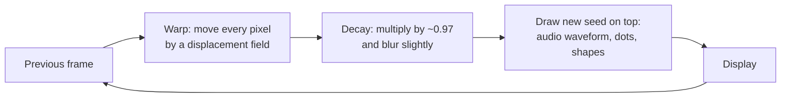

# How feedback visualisers like Geiss and MilkDrop work

Geiss (a Winamp plugin and screensaver from the late 1990s) and MilkDrop (its GPU successor) are both by Ryan Geiss. Most of their look comes from one technique: a video feedback loop.

## The core loop

Each frame starts from the previous frame. The program never clears the screen.



1. **Warp.** Every pixel in the new frame samples the old frame from a slightly different position. Typical terms are a small zoom, a small rotation and a swirl. A pixel near the centre might read from 0.98 times its radius, rotated by half a degree.
2. **Decay.** The result is multiplied by a value just under 1. Bilinear sampling averages neighbouring pixels, which adds a soft blur. Old content fades instead of saturating to white.
3. **Seed.** Something new is drawn on top, usually the audio waveform as an oscilloscope line. Without a seed the loop decays to black.

At 60 frames per second, a waveform drawn 30 frames ago is still visible after being zoomed, rotated and blurred 30 times. That smear is the trail. A small zoom combined with a small rotation produces logarithmic spirals. Iterating a contraction on its own output produces self-similar structure, the same mathematics as an iterated function system.

## The original Geiss (CPU only)

These details are from recollection and have not been checked against the Geiss source.

- It ran at low resolution in 8-bit palettised mode, with hand-tuned MMX and assembly inner loops.
- The warp fields were precomputed. For each destination pixel it stored the source offset and the bilinear weights of the four neighbours, so a frame cost one table lookup and a weighted average per pixel.
- Colour came from the palette. Pixel values were intensities only, and cycling the 256-entry palette recoloured the whole screen at no per-pixel cost.
- It kept several warp maps and switched or blended between them, often on detected beats.

## MilkDrop (GPU)

- The warp is a coarse mesh over the screen. Equations compute a texture coordinate per vertex, and the GPU interpolates between vertices. Arbitrary warps are cheap this way.
- A preset is a text file (`.milk`) of base values and small equations. Per-frame equations set variables such as `zoom`, `rot`, `warp`, `cx`, `cy`, `dx`, `dy`, `sx`, `sy` and `decay`. Per-vertex equations can override them using the vertex's `x`, `y`, `rad` and `ang`.
- Audio arrives as variables: `bass`, `mid` and `treb`, and their smoothed `_att` versions. 1.0 is the band's recent average. A preset can write `zoom = 1.0 + 0.05*bass` and pulse with the kick drum.
- MilkDrop 2 added a warp pixel shader and a composite pixel shader. Presets can do per-pixel colour maths in the loop and post-effects outside it.
- Switching presets crossfades between two of them, which gives the smooth morphs between scenes.

The per-vertex warp in this repository follows MilkDrop 1's order: zoom about the screen centre, stretch about `(cx, cy)`, the four-sine animated warp, rotation about `(cx, cy)`, then translation. `computeMesh` in `src/feedback.cpp` is the implementation.

## Minimal version

```cpp
// prev and next are float RGB images, W x H
for (int y = 0; y < H; ++y)
for (int x = 0; x < W; ++x) {
    float u = (x - W*0.5f) / W, v = (y - H*0.5f) / H;
    float r = std::sqrt(u*u + v*v), a = std::atan2(v, u);
    r *= 0.97f + 0.02f * bass;          // zoom in
    a += 0.01f + 0.05f * r;             // rotate, with swirl
    float su = r*std::cos(a)*W + W*0.5f;
    float sv = r*std::sin(a)*H + H*0.5f;
    next(x, y) = bilinear(prev, su, sv) * 0.96f;   // warp + decay
}
drawWaveform(next, audioSamples);       // seed
std::swap(prev, next);
```

Most of the variety between presets comes from how the warp equations vary with position and time. The seed matters much less.
